# 🏛️ Documento de Arquitetura do Sistema — CoreBot

O **CoreBot** foi projetado seguindo os princípios de Arquitetura Limpa (Clean Architecture), modularidade orientada a recursos (*feature-based modular architecture*), separação estrita de responsabilidades, observabilidade e alta tolerância a falhas.

---

## 1. Visão Geral da Arquitetura

```mermaid
flowchart TD
    subgraph Discord["Discord Gateway & API"]
        Gateway["Eventos Gateway (voiceStateUpdate, interactionCreate)"]
        SlashAPI["Discord REST Slash Commands"]
    end

    subgraph HTTP["Camada HTTP & Observabilidade (Fastify)"]
        FastifyServer["Fastify Server (Porta 3000)"]
        HealthRoute["/health & /live"]
        MetricsRoute["/metrics (Prometheus prom-client)"]
        BullBoardRoute["/admin/queues (Bull-Board + Basic Auth)"]
        WebhookRoutes["/api/webhooks/deploy & alerts (X-Webhook-Token)"]
    end

    subgraph Security["Camada de Segurança & Guardas"]
        GuildGuard["GuildGuard (Isolamento de Servidor)"]
        PermGuard["PermissionGuard (Admin / Cargos DB)"]
    end

    subgraph Core["Core & Injeção de Dependências"]
        DI["Container (Service Locator / DI)"]
        ModReg["Module Registry (Descoberta & Ciclo de Vida)"]
    end

    subgraph Modules["Módulos de Domínio"]
        ModAdmin["AdminModule"]
        ModVoice["VoiceNotificationModule"]
        ModAgenda["AgendaModule"]
        ModLists["AttendeeListsModule"]
        ModBdays["BirthdayModule"]
        ModHub["VoiceHubModule (Salas Dinâmicas)"]
        ModGame["GameMonitorModule (Minecraft/Source/TCP)"]
        ModWeb["WebhooksModule (CI/CD e Alertas)"]
        ModRoles["CustomRolesModule (Cargos Estéticos)"]
        ModQuotes["QuotesModule (Pérolas & Citações)"]
        ModMatch["MatchmakingModule (Lobbies & Threads)"]
        ModClips["ClipsModule (Catálogo & Votações)"]
        ModTribunal["TribunalModule (Julgamentos & Penas)"]
        ModSound["SoundboardModule (Áudios em Call)"]
        ModSocial["SocialAnalyticsModule (Wrapped & Countdowns)"]
    end

    subgraph Services["Serviços Centrais do Sistema"]
        NotifService["NotificationService (Retry, Backoff, Deduplicação)"]
        TemplateService["MessageTemplateService (Placeholders, Embeds, Fallback)"]
    end

    subgraph Jobs["Filas e Processamento em Segundo Plano"]
        BullMQ["BullMQ Queues & Workers"]
        Redis[("Redis 7 (Persistente)")]
    end

    subgraph Database["Camada de Persistência"]
        Repos["Repositórios Tipados"]
        Prisma["Prisma ORM"]
        Postgres[("PostgreSQL 16")]
    end

    Gateway --> GuildGuard
    GuildGuard --> PermGuard
    PermGuard --> ModReg
    ModReg --> Modules

    FastifyServer --> HealthRoute
    FastifyServer --> MetricsRoute
    FastifyServer --> BullBoardRoute
    FastifyServer --> WebhookRoutes
    WebhookRoutes --> ModWeb

    Modules --> Services
    Services --> NotifService
    Services --> TemplateService

    Modules --> Repos
    Repos --> Prisma
    Prisma --> Postgres

    Modules --> BullMQ
    BullMQ --> Redis
    BullMQ --> NotifService
    NotifService --> SlashAPI
```



---

## 2. Princípios e Regras Arquiteturais

### 2.1. Isolamento Rigoroso de Servidor (Guild Guard)
- O bot foi concebido para uso estritamente privado em servidores autorizados configurados na variável `DISCORD_ALLOWED_GUILD_IDS`.
- Toda e qualquer interação recebida do Discord passa pelo `GuildGuard`. Se a guilda de origem não estiver na lista permitida, o evento ou comando é silenciosamente ignorado e descartado.
- Os comandos slash são registrados pontualmente e imediatamente apenas nas guildas autorizadas via `Routes.applicationGuildCommands`.

### 2.2. Separação de Camadas
Cada módulo é estritamente separado em:
1. **Handler / Comandos**: Tratam as interações do Discord (slash commands, botões, modais, menus de seleção).
2. **Serviço de Negócio**: Executa a regra de negócio do recurso, sem acoplamento direto com o Discord UI.
3. **Repositório**: Abstrai as consultas ao Prisma. Nenhum módulo executa `prisma.<model>` diretamente.
4. **Schemas (Zod)**: Validam as entradas de dados antes de processar qualquer persistência.

### 2.3. Sistema Central de Notificações (`NotificationService`)
Nenhum módulo envia mensagens diretamente para canais ou DMs usando `channel.send()`. Toda comunicação passa pelo `NotificationService`, garantindo:
- **Verificação de Permissões**: Verifica se o bot tem `ViewChannel`, `SendMessages` e `EmbedLinks` no canal de destino antes de enviar.
- **Deduplicação de Eventos**: Previne disparos acidentais em reconexões ou múltiplos cliques via cache TTL em memória.
- **Retry Exponencial**: Lida com lentidão de rede e rate limits da API do Discord.
- **Log Centralizado**: Grava todo sucesso ou falha no modelo `NotificationLog` do banco de dados.

### 2.4. Dashboard de Filas (Bull-Board) e Observabilidade (Prometheus)
- Servidor HTTP leve acoplado via **Fastify** expondo:
  - `/admin/queues`: Painel visual do `@bull-board/fastify` protegido por HTTP Basic Authentication (`ADMIN_DASHBOARD_USER` / `ADMIN_DASHBOARD_PASS`).
  - `/metrics`: Métricas do Prometheus via `prom-client` monitorando latência de ping do Discord, salas de voz ativas, total de eventos processados e status de todas as filas BullMQ.
  - `/health` e `/live`: Endpoints para verificação de saúde e orquestração Docker/Kubernetes.
  - `/api/webhooks/deploy` e `/api/webhooks/alerts`: Endpoints de integração externa autenticados por cabeçalho `X-Webhook-Token`.

### 2.5. Canais Dinâmicos de Voz (Temp Voice Hubs)
- Módulo `VoiceHubModule` com lógica reativa no evento `voiceStateUpdate`.
- Criação sob demanda de salas temporárias com delegação de propriedade ao criador, painel fixo de botões (trancar, alterar limite via Modal, transferir posse via Select Menu) e remoção automática quando o canal fica vazio.

### 2.6. Monitoramento de Servidores de Jogos (Game Server Monitor)
- Módulo `GameMonitorModule` com suporte nativo a:
  - **Minecraft (Java SLP)** via pacotes TCP.
  - **Source Engine (A2S_INFO)** via datagramas UDP.
  - **TCP Genérico** via teste de handshake.
- Worker assíncrono em fila BullMQ atualizando embeds em tempo real no canal designado.

### 2.7. Cargos Personalizados e Estéticos (Custom Roles)
- Módulo `CustomRolesModule` com comando `/meucargo` e evento `guildMemberRemove`.
- Criação e atribuição de cargo personalizado com estrito controle de segurança: `permissions: 0n`.
- Posicionamento dinâmico do cargo criado diretamente abaixo da role âncora configurada (`anchorRoleId`), garantindo que não ultrapasse a hierarquia visual.
- Limite de 1 cargo customizado por usuário por guilda com unicidade no banco de dados (`@@unique([guildId, userId])`).
- Validação estrita de formato hexadecimal (`/^#[0-9A-F]{6}$/i`).
- Descarte reativo: deleção física do cargo no Discord e exclusão do banco de dados na saída do membro do servidor (`guildMemberRemove`).

### 2.8. Pérolas & Citações (Quotes)
- Módulo `QuotesModule` com Message Context Menu (`Salvar Pérola`), comandos `/perola` e paginação interativa.
- Scheduler semanal via BullMQ (`QuotesScheduler`) sorteando e publicando a "Pérola da Semana" todo domingo às 20h.

### 2.9. Painel de Jogatina & Lobbies (Matchmaking)
- Módulo `MatchmakingModule` com `/jogar` e botões de inscrição/saída.
- Scheduler resiliente via BullMQ (`MatchmakingScheduler`) que dispara a abertura de thread dedicada na mensagem e marca todos os confirmados quando as vagas se esgotam ou no horário de início.

### 2.10. Catálogo de Clipes & Momentos (Clips)
- Módulo `ClipsModule` com validação de domínios (Medal, YouTube, Twitch, etc.) e botões atômicos de votação com alternância de voto (`🔥 Mandou bem` / `💀 Cringe`).
- Scheduler mensal via BullMQ (`ClipsScheduler`) elegendo o "Clipe do Mês" no 1º dia de cada mês.

### 2.11. Tribunal do Servidor (Tribunal)
- Módulo `TribunalModule` com julgamento relâmpago de 10 minutos, botões de votação e veredito por maioria.
- Alteração automática de apelido do réu condenado e agendamento de expiração via BullMQ (`TribunalScheduler`) para restaurar o apelido original.

### 2.12. Soundboard em Call (Soundboard)
- Módulo `SoundboardModule` utilizando `@discordjs/voice`, `prism-media` e `ffmpeg-static`.
- Comandos `/tocar` e `/sons listar` com controle de concorrência por canal e auto-disconnect após o término do áudio.

### 2.13. Wrapped & Social Analytics (Social Analytics)
- Módulo `SocialAnalyticsModule` com rastreamento contínuo em `voiceStateUpdate`.
- Retrospecto mensal ("Wrapped do Mês"), despedidas automáticas bem-humoradas na madrugada (01:00 às 06:00) e contagens regressivas diárias (`/countdown`).

---

## 3. Estrutura de Diretórios

```text
src/
  config/                  # Validação Zod de ambiente (.env) e constantes do sistema
  core/                    # Container de DI, Registry de módulos e interfaces
  database/                # Instância Prisma e Repositórios por entidade
  discord/                 # Cliente Discord, guardas de acesso e handlers de interação
  jobs/                    # Conexão Redis, abstração BullMQ e workers agendados
  modules/
    admin/                 # Painel de administração e auditoria de permissões
    agenda/                # Eventos com lembretes programados
    attendee-lists/        # Listas com botões interativos e exportação CSV
    birthdays/             # Aniversários automáticos com fuso horário
    clips/                 # Catálogo de clipes, votos e Clipe do Mês
    custom-roles/          # Cargos estéticos personalizados com zero permissões
    game-monitor/          # Monitor de servidores de jogos (Minecraft, Source, TCP)
    matchmaking/           # Lobbies de jogos com threads automáticas
    quotes/                # Pérolas salvas via Apps e sorteio semanal
    social-analytics/      # Wrapped de voz, despedidas na madrugada e countdowns
    soundboard/            # Áudios locais em canais de voz (@discordjs/voice)
    tribunal/              # Votações relâmpago e castigos temporários de apelido
    voice-hub/             # Salas dinâmicas temporárias com painel de controle
    voice-notifications/   # Avisos de entrada e saída em canais de voz
    webhooks/              # Endpoints HTTP para deploys CI/CD e alertas
  services/                # Serviços centrais (NotificationService, TemplateService)
  types/                   # Tipagens e contratos TypeScript
  utils/                   # Logger Pino, Timezone (Dayjs), EmbedBuilder, Fastify HTTP e Métricas
  index.ts                 # Bootstrap da aplicação e encerramento seguro (Graceful Shutdown)
```
