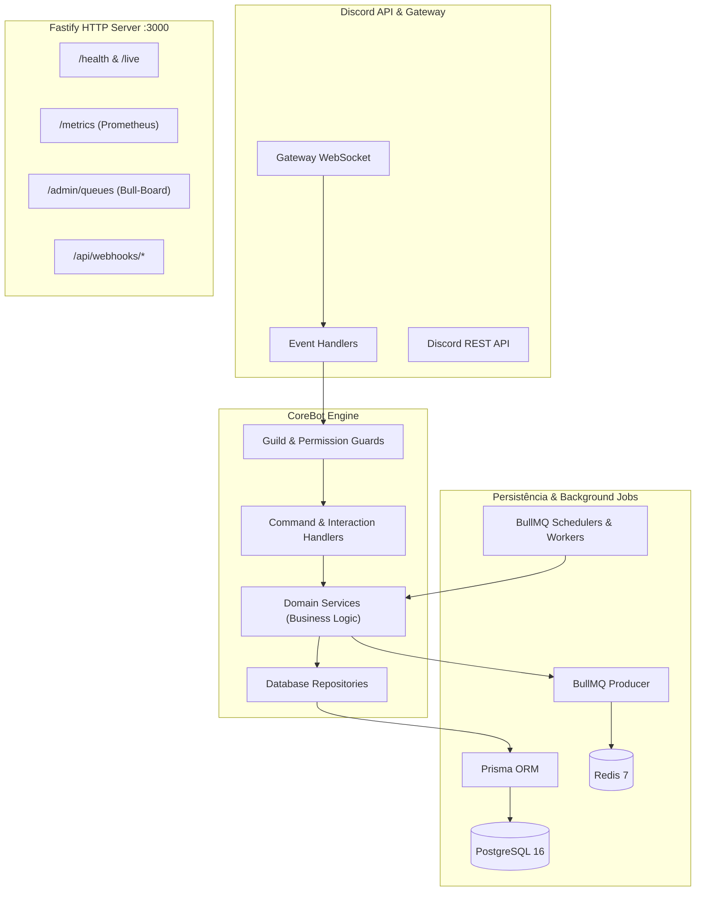

<div align="center">

# 🤖 CoreBot — Private Discord Ecosystem

**Um ecossistema privado, modular e de alto desempenho para servidores de amigos no Discord.**  
Construído com **Clean Architecture**, resiliência operacional, observabilidade em tempo real e automação avançada.

[](https://discord.js.org/)
[](https://nodejs.org/)
[](https://www.typescriptlang.org/)
[](https://www.postgresql.org/)
[](https://www.prisma.io/)
[](https://bullmq.io/)
[](https://www.docker.com/)
[](https://vitest.dev/)

[Visão Geral](#-visão-geral) • [Demonstração Visual](#-demonstração-visual-do-discord) • [Módulos](#-módulos-integrados) • [Arquitetura](#-arquitetura-e-fluxo-de-dados) • [Instalação](#-instalação-e-execução) • [Documentação](docs/COMMANDS.md)

---

</div>

## 📌 Visão Geral

O **CoreBot** foi desenvolvido para atender às necessidades reais de servidores privados do Discord. Ele combina ferramentas de moderação visual, automação social, monitoramento de servidores de jogos e notificações em tempo real com as melhores práticas de engenharia de software:

* **Isolamento e Segurança Estrita:** Opera unicamente nos servidores autorizados (`DISCORD_ALLOWED_GUILD_IDS`), ignorando qualquer interação de origens desconhecidas.
* **Tipagem 100% Estrita:** TypeScript em modo estrito sem recurso a `any`, garantindo confiabilidade em tempo de compilação.
* **Validação em Tempo de Execução:** Todas as entradas de dados e variáveis de ambiente são validadas declarativamente via **Zod**.
* **Tarefas em Segundo Plano:** Agendamentos resilientes com tolerância a falhas via **BullMQ** e **Redis**.
* **Observabilidade Pronta para Produção:** Métricas nativas para Prometheus (`/metrics`) e painel visual de filas via **Bull-Board** (`/admin/queues`).

---

## 🎨 Demonstração Visual do Discord

Abaixo você confere como os módulos interativos do CoreBot são renderizados diretamente na interface do Discord.

### 🎙️ 1. Salas de Voz Dinâmicas (*Temp Voice Hub*) & Painel de Controle

Quando um membro entra no canal gatilho (`➕ Criar Sala` ou `🔒 Criar Privada`), o CoreBot cria a sala temporária sob demanda, move o usuário instantaneamente e envia o painel de gerenciamento exclusivo:

```
┌────────────────────────────────────────────────────────────────────────────────────────┐
│ 🤖 CoreBot BOT — Hoje às 20:15                                                        │
├────────────────────────────────────────────────────────────────────────────────────────┤
│ ▌ 🎙️ Painel de Controle da Sala                                                       │
│ ▌ 👑 Dono da Sala: @Lucas                                                              │
│ ▌ 🔒 Status: Trancada (Privada)                                                        │
│ ▌                                                                                      │
│ ▌ Utilize os botões abaixo para gerenciar a sua sala de voz temporária em tempo real:  │
├────────────────────────────────────────────────────────────────────────────────────────┤
│  [ 🔒 Trancar / Destrancar ]   [ ➕ Convidar Amigo ]   [ 🚫 Expulsar ]                  │
│  [ 👥 Definir Limite ]         [ ✏️ Renomear Sala ]    [ 👑 Passar Liderança ]          │
└────────────────────────────────────────────────────────────────────────────────────────┘
```

> **Comandos complementares:** Membros na sala também podem usar `/sala trancar`, `/sala destrancar`, `/sala convidar @amigo`, `/sala expulsar @alvo`, `/sala limite 5` e `/sala renomear "Trio Ranked"`.

---

### 🕹️ 2. Painel de Jogatina & Lobbies Dinâmicos (`/jogar`)

Criação de sessões de jogos com confirmação em tempo real e menção automática quando o time fechar:

```
┌────────────────────────────────────────────────────────────────────────────────────────┐
│ 🤖 CoreBot BOT — Hoje às 21:00                                                        │
├────────────────────────────────────────────────────────────────────────────────────────┤
│ ▌ 🎮 Lobby de Jogatina: Valorant Competitivo                                           │
│ ▌ 👑 Líder: @Rodrigo | 🎯 Modo: Competitivo                                            │
│ ▌ 👥 Vagas: 3 / 5 vagas preenchidas                                                    │
│ ▌                                                                                      │
│ ▌ Confirmados:                                                                         │
│ ▌ 1. @Rodrigo (Líder)                                                                  │
│ ▌ 2. @Gabriel                                                                          │
│ ▌ 3. @Matheus                                                                          │
│ ▌ ⏳ Aberto há 5 minutos                                                               │
├────────────────────────────────────────────────────────────────────────────────────────┤
│  [ 🟢 Entrar na Call ]   [ 🔴 Sair do Lobby ]   [ 🔔 Notificar Inscritos ]             │
└────────────────────────────────────────────────────────────────────────────────────────┘
```

---

### 💬 3. Pérolas & Citações da Galera (`/perola`)

Capturadas com um clique pelo Menu de Contexto (*Apps > Salvar Pérola*) e sorteadas na "Pérola da Semana" todo domingo às 20h:

```
┌────────────────────────────────────────────────────────────────────────────────────────┐
│ 🤖 CoreBot BOT — Domingo às 20:00                                                     │
├────────────────────────────────────────────────────────────────────────────────────────┤
│ ▌ 🏆 Pérola da Semana!                                                                 │
│ ▌                                                                                      │
│ ▌ "Se a gente não rushar agora pelo meio, eles nunca vão esperar que a gente vá pelo   │
│ ▌ meio de novo pela quarta vez seguida!"                                               │
│ ▌                                                                                      │
│ ▌ 👤 Autor: @Danilo                                                                    │
│ ▌ 💾 Salvo por: @Lucas | 📅 08/10/2026 no canal #chat-geral                            │
└────────────────────────────────────────────────────────────────────────────────────────┘
```

---

### ⚖️ 4. Tribunal do Servidor (`/tribunal`)

Votações democráticas relâmpago para julgar atitudes suspeitas na call com aplicação de castigo de apelido temporário:

```
┌────────────────────────────────────────────────────────────────────────────────────────┐
│ 🤖 CoreBot BOT — Hoje às 22:40                                                        │
├────────────────────────────────────────────────────────────────────────────────────────┤
│ ▌ ⚖️ Tribunal do Servidor — Caso #042                                                  │
│ ▌ 👤 Réu: @Bruno | 🏛️ Acusador: @Felipe                                               │
│ ▌ 📜 Motivo: Flashou o time inteiro de propósito no round decisivo                    │
│ ▌ ⏳ Tempo restante: 06 minutos                                                        │
│ ▌                                                                                      │
│ ▌ Votação da Comunidade:                                                               │
│ ▌ 🟩 INOCENTE:  [██████                  ] 3 votos (30%)                               │
│ ▌ 🟥 CULPADO:   [██████████████          ] 7 votos (70%)                               │
├────────────────────────────────────────────────────────────────────────────────────────┤
│  [ 🟩 Votar Inocente ]   [ 🟥 Votar Culpado ]                                          │
└────────────────────────────────────────────────────────────────────────────────────────┘
```

---

### 📡 5. Notificações de Lives da Twitch & Monitor de Servidores

Alertas automáticos com detecção de status online/offline, título e miniatura em tempo real:

```
┌────────────────────────────────────────────────────────────────────────────────────────┐
│ 🤖 CoreBot BOT — Hoje às 19:10                                                        │
├────────────────────────────────────────────────────────────────────────────────────────┤
│ ▌ 🟣 @Streamer está AO VIVO na Twitch!                                                 │
│ ▌ 🎮 Categoria: Grand Theft Auto V                                                     │
│ ▌ 🔴 Título: Subindo ranking e jogando com os inscritos!                               │
│ ▌ 👥 Espectadores: 142 | 🌐 Assista em: https://twitch.tv/streamer                     │
└────────────────────────────────────────────────────────────────────────────────────────┘
```

---

## 📦 Módulos Integrados

O CoreBot é composto por 17 submódulos desacoplados organizados por domínio:

| Módulo | Comando Principal | Descrição Principal |
| :--- | :--- | :--- |
| **Temp Voice Hubs** | `/voice-hub` & `/sala` | Criação de salas temporárias dinâmicas com suporte a salas públicas/privadas e whitelist. |
| **Voice Notifications** | `/voz-notificar` | Avisos de entrada, saída e movimentação entre salas com mapeamento customizado para múltiplos chats. |
| **Painel de Jogatina** | `/jogar` | Lobbies com botões interativos, vagas pré-definidas e menção automática aos membros. |
| **Pérolas & Citações** | `/perola` | Registro via Context Menu (`Apps > Salvar Pérola`), paginação de citações e sorteio semanal. |
| **Tribunal do Servidor** | `/tribunal` | Julgamento interativo da comunidade com castigo temporário de apelido via BullMQ. |
| **Clipes & Momentos** | `/clip` | Acervo de vídeos e clipes com votação comunitária (`🔥` / `💀`) e eleição do clipe do mês. |
| **Soundboard em Call** | `/tocar` & `/sons` | Reprodução de áudios em chamadas com upload seguro de arquivos e autocomplete de busca. |
| **Stream Notifier** | `/stream` | Monitoramento de streamers da Twitch via OAuth2 em background com publicação de embeds. |
| **Game Server Monitor** | `/server` | Ping contínuo e status em tempo real de servidores **Minecraft**, **Valve Source (CS/TF2)** e **TCP**. |
| **Wrapped & Social** | `/wrapped` & `/countdown` | Métricas de tempo em voz, badges sociais, despedida noturna bem-humorada e contagens regressivas. |
| **Custom Roles** | `/meucargo` | Criação de cargos cosméticos com cor hexadecimal, posicionados sob cargo âncora seguro (`perms: 0n`). |
| **Agenda & Reuniões** | `/agenda` | Marcação de eventos com lembretes progressivos (60, 30, 10 min) respeitando o fuso do servidor. |
| **Listas de Presença** | `/lista` | Confirmação de presença em eventos com botões interativos e exportação em CSV. |
| **Aniversários** | `/aniversario` | Cadastro e felicitações automáticas na data comemorativa com cálculo de idade. |
| **Webhooks Internos** | `/webhook` | Endpoints HTTP Fastify autenticados para alertas de CI/CD (GitHub/GitLab) e Uptime. |
| **Administração Geral** | `/bot` | Backup seguro do banco de dados no Discord, auditoria de canais e healthcheck. |

---

## 🏗️ Arquitetura e Fluxo de Dados

O CoreBot utiliza os princípios de **Clean Architecture** e **Inversion of Control (IoC)**:



---

## 🚀 Instalação e Execução

### Opção 1: Execução com Docker (Recomendado)

O CoreBot está totalmente configurado para rodar via **Docker Compose multi-stage** com orquestração de migrações e dependências de áudio (`ffmpeg`, `python3`, `g++`):

1. **Clone o repositório:**
   ```bash
   git clone https://github.com/LucasCamy/CoreBot.git
   cd CoreBot
   ```

2. **Configure o arquivo de ambiente:**
   ```bash
   cp .env.example .env
   # Edite o .env com seu BOT_TOKEN, DISCORD_CLIENT_ID e DISCORD_ALLOWED_GUILD_IDS
   ```

3. **Inicie todos os serviços:**
   ```bash
   docker compose up -d --build
   ```

O container executa `prisma migrate deploy` automaticamente através do script de entrypoint antes de inicializar o bot.

---

### Opção 2: Desenvolvimento Local

```bash
# 1. Instalar dependências
npm install

# 2. Gerar cliente do Prisma
npx prisma generate

# 3. Rodar suíte de testes unitários
npm test

# 4. Iniciar em modo de desenvolvimento (com recarregamento automático)
npm run dev
```

---

## 🌐 Endpoints HTTP do Servidor Interno (Porta 3000)

O bot expõe um servidor **Fastify** acoplado ao ciclo de vida da aplicação:

| Rota | Método | Autenticação | Função |
| :--- | :--- | :--- | :--- |
| `/health` | `GET` | Nenhuma | Healthcheck com verificação de conectividade do Postgres e Redis. |
| `/live` | `GET` | Nenhuma | Probe de liveness (retorna status 200). |
| `/metrics` | `GET` | Nenhuma | Coleta de métricas do **Prometheus** (latência do ping, canais de voz, eventos). |
| `/admin/queues` | `GET` | Basic Auth | Dashboard visual interativo do **Bull-Board** para inspecionar filas. |
| `/api/webhooks/deploy` | `POST` | `X-Webhook-Token` | Recebe payloads de pipelines CI/CD e notifica no Discord. |
| `/api/webhooks/alerts` | `POST` | `X-Webhook-Token` | Recebe alertas de monitoramento com embed estilizado. |

---

## ⚙️ Variáveis de Ambiente (`.env`)

| Variável | Obrigatória | Descrição |
| :--- | :---: | :--- |
| `NODE_ENV` | Sim | Ambiente de execução (`development` ou `production`). |
| `BOT_TOKEN` | Sim | Token secreto da aplicação Discord. |
| `DISCORD_CLIENT_ID` | Sim | ID da aplicação Discord. |
| `DISCORD_ALLOWED_GUILD_IDS` | Sim | IDs dos servidores autorizados separados por vírgula (ex: `123456789`). |
| `DATABASE_URL` | Sim | String de conexão PostgreSQL com pool (`?connection_limit=25&pool_timeout=20`). |
| `REDIS_HOST` | Sim | Host do Redis (padrão: `localhost` ou `redis`). |
| `REDIS_PORT` | Sim | Porta do Redis (padrão: `6379`). |
| `PORT` | Não | Porta do servidor HTTP Fastify (padrão: `3000`). |
| `ADMIN_DASHBOARD_USER` | Sim | Usuário para login no Bull-Board. |
| `ADMIN_DASHBOARD_PASS` | Sim | Senha para login no Bull-Board. |
| `TWITCH_CLIENT_ID` | Não | Client ID da API da Twitch para monitoramento de lives. |
| `TWITCH_CLIENT_SECRET` | Não | Client Secret da API da Twitch para renovação automática de token. |

---

## 🧪 Qualidade de Código e Testes

O projeto conta com suíte de testes automatizados com **Vitest**, análise estática rigorosa com **ESLint** e formatação com **Prettier**:

```bash
# Executar todos os testes unitários
npm test

# Executar linter
npm run lint

# Verificar padronização de formatação
npm run format:check

# Compilar projeto para produção
npm run build
```

---

## 📄 Licença

Distribuído sob a licença **MIT**. Consulte o arquivo de licença para mais informações.

Desenvolvido com carinho para proporcionar a melhor experiência comunitária no Discord! 🚀
