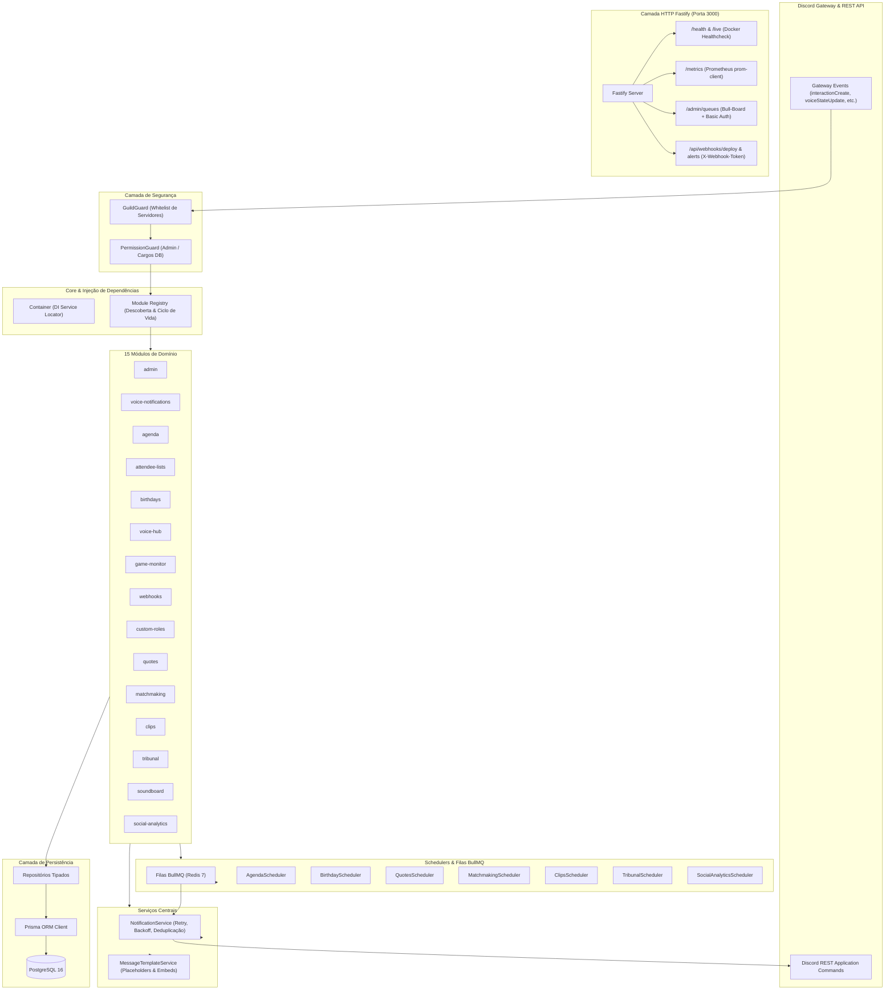

# 📘 Documentação Geral do Sistema — CoreBot

> **Versão:** 1.3.0  
> **Status:** Produção / Base Estável  
> **Arquitetura:** Clean Architecture Modular (Feature-Based)  
> **Linguagem & Runtime:** Node.js 20+ (ESM) com TypeScript Estrito  
> **Framework Discord:** discord.js v14 & @discordjs/voice  
> **Banco de Dados & ORM:** PostgreSQL 16 + Prisma ORM  
> **Filas & Cache:** Redis 7 + BullMQ + Cache L1 In-Memory  
> **Servidor HTTP:** Fastify (Bull-Board, Prometheus Metrics, Webhooks)

---

## 📑 Sumário

1. [Visão Geral e Propósito](#1-visão-geral-e-propósito)
2. [Stack Tecnológica Completa](#2-stack-tecnológica-completa)
3. [Arquitetura e Padrões de Projeto](#3-arquitetura-e-padrões-de-projeto)
4. [Estrutura de Diretórios](#4-estrutura-de-diretórios)
5. [Segurança, Guardas e Tratamento de Casos de Borda](#5-segurança-guardas-e-tratamento-de-casos-de-borda)
6. [Catálogo dos 16 Módulos Implementados](#6-catálogo-dos-16-módulos-implementados)
7. [Processamento em Segundo Plano e Filas BullMQ](#7-processamento-em-segundo-plano-e-filas-bullmq)
8. [Camada HTTP, Observabilidade e Webhooks](#8-camada-http-observabilidade-e-webhooks)
9. [Modelo Relacional do Banco de Dados (Prisma)](#9-modelo-relacional-do-banco-de-dados-prisma)
10. [Containerização e Infraestrutura Docker](#10-containerização-e-infraestrutura-docker)
11. [Diagnóstico Crítico e Oportunidades de Melhoria](#11-diagnóstico-crítico-e-oportunidades-de-melhoria)

---

## 1. Visão Geral e Propósito

O **CoreBot** foi concebido como um bot corporativo e privado para Discord, focado em alta confiabilidade, manutenibilidade e modularidade. Ele opera exclusivamente em servidores autorizados via whitelist estrita (`DISCORD_ALLOWED_GUILD_IDS`), ignorando qualquer requisição ou evento externo.

### Objetivos Principais:

- **Modularidade Total:** Cada recurso vive em seu próprio módulo encapsulado com comandos, botões, modais, eventos, serviços, repositórios e schemas de validação.
- **Tolerância a Falhas:** Isolamento de falhas por módulo, reconexão automática, retries com backoff exponencial para chamadas à API do Discord e deduplicação de mensagens.
- **Transparência e Observabilidade:** Métricas em tempo real para Prometheus, dashboard interativo de filas (Bull-Board) e logging estruturado via Pino com redação de dados sensíveis.
- **Comunidade & Engajamento:** Recursos avançados para servidores fechados de amigos: lobbies de jogos com threads automáticas, votação de clipes, soundboard de voz, tribunal com castigos estéticos, histórico de pérolas e Wrapped mensal.

---

## 2. Stack Tecnológica Completa

| Categoria              | Tecnologia                                               | Justificativa Técnica                                                                              |
| :--------------------- | :------------------------------------------------------- | :------------------------------------------------------------------------------------------------- |
| **Runtime**            | Node.js 20+ LTS                                          | Suporte nativo a ESM, performance V8 atualizada e APIs modernas de timers/streams.                 |
| **Linguagem**          | TypeScript 5.7+                                          | Tipagem estrita (`strict: true`), zero uso de `any`, compilação direta via `tsc`.                  |
| **Discord API**        | discord.js v14.18                                        | Biblioteca oficial orientada a objetos para o Discord Gateway v10 e REST API.                      |
| **Áudio em Voz**       | @discordjs/voice, prism-media, ffmpeg-static, opusscript | Conexão com canais de voz UDP, pipeline de decodificação e streaming de áudio local.               |
| **Banco de Dados**     | PostgreSQL 16                                            | RDBMS robusto com transações ACID, integridade referencial e suporte a tipos nativos.              |
| **ORM**                | Prisma 6.4                                               | Type-safe queries, migrations automatizadas, modelagem declarativa e introspecção.                 |
| **Filas & Jobs**       | BullMQ 5.41 + Redis 7                                    | Gerenciamento de tarefas em segundo plano, agendamentos cron, retries e escalabilidade horizontal. |
| **Dashboard de Filas** | @bull-board/fastify                                      | Interface web visual para monitorar, pausar e reexecutar jobs das filas.                           |
| **Servidor HTTP**      | Fastify 5.12                                             | Servidor HTTP de baixíssima sobrecarga (low overhead) para healthchecks, métricas e webhooks.      |
| **Métricas**           | prom-client 15.1                                         | Exposição de métricas Prometheus (latência Discord, eventos, voz, filas BullMQ).                   |
| **Validação**          | Zod 3.24                                                 | Validação de runtime declarativa para `.env`, payloads de comandos e webhooks (fail-fast).         |
| **Datas & Fuso**       | Dayjs 1.11 (Timezone, UTC, CustomParse)                  | Manipulação leve de fusos horários sem a sobrecarga do Moment.js.                                  |
| **Logger**             | Pino 9.6 + Pino-Pretty                                   | Logging estruturado em JSON de alta performance com redação de tokens e senhas.                    |
| **Testes**             | Vitest 3.0                                               | Executor de testes unitários ultrarrápido compatível nativamente com ESM e TypeScript.             |
| **Docker**             | Multi-stage build (Alpine Linux)                         | Imagens de produção mínimas, seguras, executando sob usuário não-root (`corebot`).                 |

---

## 3. Arquitetura e Padrões de Projeto

O sistema adota uma arquitetura em camadas orientada a recursos (_Feature-Based Clean Architecture_):



### Regras Estritas de Separação de Camadas:

1. **Handlers de Interação (`commands/`, `buttons/`, `events/`):** Apenas recebem a requisição do Discord, validam dados com Zod e delegam ao serviço correspondente.
2. **Serviços de Domínio (`services/`):** Contêm 100% das regras de negócio. Nunca fazem queries diretas no Prisma nem chamam `channel.send()` sem passar pelo repositório ou pelo `NotificationService`.
3. **Repositórios (`repositories/`):** Única camada com acesso ao `prisma.<model>`. Abstraem operações de banco e transações.
4. **Isolamento de Erros:** Erros em um módulo nunca quebram o bot inteiro. Erros de interação respondem com mensagens efêmeras amigáveis e logam stack trace estruturado no Pino.

---

## 4. Estrutura de Diretórios

```text
BotDiscord-Uganda/
├── assets/
│   └── sounds/                     # Áudios locais para o soundboard (.wav, .mp3, .ogg)
├── docs/
│   ├── ADD_NEW_MODULE.md           # Guia passo a passo para criar novos módulos
│   ├── COMMANDS.md                 # Manual completo de todos os comandos slash
│   ├── DEPLOY.md                   # Guia de deploy em VPS/Docker
│   └── SYSTEM_OVERVIEW.md          # Este documento técnico detalhado
├── prisma/
│   ├── migrations/                 # Migrações SQL versionadas
│   └── schema.prisma               # Modelagem relacional completa do PostgreSQL
├── src/
│   ├── config/
│   │   ├── constants.ts            # Cores, emojis, permissões e nomes de filas BullMQ
│   │   └── env.ts                  # Validação estrita das variáveis do .env via Zod
│   ├── core/
│   │   ├── container.ts            # Container de Injeção de Dependências
│   │   └── module.registry.ts      # Registro dinâmico de módulos, comandos e eventos
│   ├── database/
│   │   ├── prisma.ts               # Singleton e ciclo de vida do Prisma Client
│   │   └── repositories/           # Repositórios por domínio
│   │       ├── agenda.repository.ts
│   │       ├── attendee.repository.ts
│   │       ├── birthday.repository.ts
│   │       ├── clip.repository.ts
│   │       ├── custom-role.repository.ts
│   │       ├── game-server.repository.ts
│   │       ├── guild.repository.ts
│   │       ├── matchmaking.repository.ts
│   │       ├── notification-log.repository.ts
│   │       ├── quote.repository.ts
│   │       ├── social-analytics.repository.ts
│   │       ├── tribunal.repository.ts
│   │       ├── voice-hub.repository.ts
│   │       ├── voice.repository.ts
│   │       └── webhook.repository.ts
│   ├── discord/
│   │   ├── client.ts               # Extensão tipada do discord.js Client
│   │   ├── deploy-commands.ts      # Registro REST de Slash e Context Menu commands
│   │   ├── guards/
│   │   │   ├── guild.guard.ts      # Isolamento de servidores permitidos
│   │   │   └── permission.guard.ts # Verificação de permissões administrativas
│   │   └── handlers/
│   │       └── interaction.handler.ts # Despachante central de comandos, botões e modais
│   ├── jobs/
│   │   ├── queue.ts                # Gerenciador de filas e workers BullMQ
│   │   ├── redis.ts                # Conexão singleton com Redis
│   │   └── schedulers/             # Workers recorrentes e agendadores de tarefas
│   │       ├── agenda.scheduler.ts
│   │       ├── birthday.scheduler.ts
│   │       ├── clips.scheduler.ts
│   │       ├── matchmaking.scheduler.ts
│   │       ├── quotes.scheduler.ts
│   │       ├── social-analytics.scheduler.ts
│   │       └── tribunal.scheduler.ts
│   ├── modules/                    # Os 15 módulos independentes de domínio
│   │   ├── admin/
│   │   ├── agenda/
│   │   ├── attendee-lists/
│   │   ├── birthdays/
│   │   ├── clips/
│   │   ├── custom-roles/
│   │   ├── game-monitor/
│   │   ├── matchmaking/
│   │   ├── quotes/
│   │   ├── social-analytics/
│   │   ├── soundboard/
│   │   ├── tribunal/
│   │   ├── voice-hub/
│   │   ├── voice-notifications/
│   │   └── webhooks/
│   ├── services/
│   │   ├── notification.service.ts # Disparo com deduplicação, retry e auditoria
│   │   └── template.service.ts     # Substituição de placeholders em mensagens
│   ├── types/
│   │   └── index.ts                # Contratos, interfaces e tipos de comandos/módulos
│   ├── utils/
│   │   ├── embed.builder.ts        # Padronização de embeds estilizados
│   │   ├── healthcheck.ts          # Checagem de integridade do Postgres e Redis
│   │   ├── http.server.ts          # Servidor Fastify (Bull-Board, Prometheus, Webhooks)
│   │   ├── logger.ts               # Logger estruturado Pino
│   │   ├── metrics.ts              # Métricas do Prometheus via prom-client
│   │   └── time.ts                 # Parsing e formatação de datas com timezone Dayjs
│   └── index.ts                    # Bootstrap e encerramento seguro (Graceful Shutdown)
├── tests/                          # Suíte de testes automatizados com Vitest
├── docker-compose.yml              # Orquestração (Bot + PostgreSQL + Redis)
├── docker-entrypoint.sh            # Script de inicialização com migração automática
└── Dockerfile                      # Build multi-stage com compilação de áudio nativo
```

---

## 5. Segurança, Guardas e Tratamento de Casos de Borda

### 5.1. GuildGuard (Isolamento de Servidor)

- Toda e qualquer interação recebida do Discord passa pelo `GuildGuard.isAllowed(guildId)`.
- Se a guilda não constar na variável `DISCORD_ALLOWED_GUILD_IDS`, a requisição é descartada de forma silenciosa e imediata.
- Os comandos de aplicação são registrados **apenas** nas guildas autorizadas via `Routes.applicationGuildCommands` (registro instantâneo sem delay de cache global).

### 5.2. PermissionGuard (Administração e Cargos do Banco)

- Comandos administrativos verificam se o membro é o Dono do Servidor, se tem a permissão `Administrator` no Discord ou se possui um dos cargos cadastrados na tabela `guild_configs.adminRoleIds`.

### 5.3. Hierarquia no Tribunal e Imunidade Soberana

- Antes de iniciar qualquer julgamento com `/tribunal julgar`, o bot valida:
  1. `ctx.guild.ownerId === targetUser.id`: O Dono do Servidor tem imunidade soberana contra o tribunal.
  2. `!targetMember.manageable`: Se o réu tem cargo superior ou igual ao CoreBot, o julgamento é bloqueado imediatamente, impedindo que votações inúteis sejam abertas.

### 5.4. Segurança Estrita em Cargos Customizados (`/meucargo`)

- Cargos criados por usuários comuns recebem `permissions: 0n` na API do Discord, impossibilitando qualquer escalada de privilégios.
- O cargo é forçosamente posicionado abaixo do cargo âncora (`anchorRoleId`) configurado pelo administrador.
- Se o membro sair do servidor (`guildMemberRemove`), o cargo é deletado do Discord e do banco.

### 5.5. Filtro de Ruído no Voice Activity (Wrapped)

- Sessões de voz com duração inferior a 30 segundos (`MIN_SESSION_DURATION_SECONDS = 30`) são ignoradas, evitando poluição de dados decorrente de quedas rápidas de conexão ou micro-trocas de sala.

### 5.6. Cooldown nas Despedidas Noturnas

- No evento de saída noturna (01:00 às 06:00), existe um cooldown em memória de 6 horas por usuário (`SIX_HOURS_MS = 6 * 60 * 60 * 1000`), evitando spam caso o membro fique caindo e voltando da chamada na madrugada.

### 5.7. Concorrência no Soundboard

- O bot mantém um lock em memória por canal de voz (`activeChannels`), rejeitando requisições simultâneas de reprodução enquanto um áudio já estiver tocando.

---

## 6. Catálogo dos 15 Módulos Implementados

### 1. Administração (`src/modules/admin`)

- **Comando:** `/bot [status | health | permissoes | config]`
- **Função:** Diagnóstico de saúde dos subsistemas (Postgres, Redis, WebSocket), auditoria de permissões de canais do bot, configuração de fuso horário e cargos autorizados.

### 2. Notificações de Voz (`src/modules/voice-notifications`)

- **Comando:** `/voz-notificar [configurar | listar | editar | remover | testar]`
- **Evento:** `voiceStateUpdate`
- **Função:** Notifica entradas, saídas e trocas de canais de voz com placeholders dinâmicos (`{user}`, `{channel}`, `{time}`, etc.), suporte a embeds e cooldown anti-spam por canal.

### 3. Agenda e Compromissos (`src/modules/agenda`)

- **Comando:** `/agenda [criar | listar | ver | editar | cancelar | lembrar]`
- **Scheduler:** `AgendaScheduler` (BullMQ)
- **Função:** Agendamento de reuniões e eventos comunitários com disparos de lembretes automáticos prévios (ex: 60, 30, 10, 5 minutos antes).

### 4. Listas de Presença (`src/modules/attendee-lists`)

- **Comando:** `/lista [criar | ver | fechar | reabrir | remover | exportar]`
- **Botões:** `list:join`, `list:leave`, `list:view`
- **Função:** Inscrição interativa com botões, atualização atômica de vagas no embed, proteção contra duplicidade e exportação para CSV.

### 5. Aniversariantes (`src/modules/birthdays`)

- **Comando:** `/aniversario [definir | remover | listar | configurar | testar]`
- **Scheduler:** `BirthdayScheduler` (BullMQ)
- **Função:** Cadastro de aniversários com timezone da guilda, cálculo automático de idade e publicação de parabéns automatizada no dia correto.

### 6. Temp Voice Hubs (`src/modules/voice-hub`)

- **Comando:** `/voice-hub [configurar | listar | remover]`
- **Evento:** `voiceStateUpdate`
- **Função:** Salas temporárias sob demanda (_Join to Create_). Ao entrar no hub gatilho, uma sala é criada para o membro com painel de botões:
  - 🔒 Trancar/Destrancar permissões do `@everyone`.
  - 👥 Alterar limite de usuários (via Modal).
  - 👑 Transferir liderança (via UserSelectMenu).
  - Auto-destruição quando o último usuário sai da sala.

### 7. Game Server Monitor (`src/modules/game-monitor`)

- **Comando:** `/server [cadastrar | listar | remover | status]`
- **Job:** `game-server-monitor-queue`
- **Função:** Monitoramento em tempo real de servidores **Minecraft (Java SLP via TCP)**, **Source Engine (A2S_INFO via UDP)** e **TCP Genérico**, atualizando embeds fixos com status, latência e jogadores online.

### 8. Webhooks Internos (`src/modules/webhooks`)

- **Comando:** `/webhook [canais | status | testar-deploy | testar-alerta]`
- **Rotas Fastify:** `POST /api/webhooks/deploy` e `POST /api/webhooks/alerts`
- **Função:** Recepção de alertas de monitoramento (Uptime Kuma, Prometheus) e pipelines de CI/CD (GitHub/GitLab) autenticados por cabeçalho `X-Webhook-Token`.

### 9. Custom Roles (`src/modules/custom-roles`)

- **Comando:** `/meucargo [criar | cor | nome | remover | admin-config]`
- **Evento:** `guildMemberRemove`
- **Função:** Criação de cargos estéticos pelo próprio usuário com cor hexadecimal validada (`/^#[0-9A-F]{6}$/i`), zero permissões (`permissions: 0n`), posicionamento sob o cargo âncora e auto-deleção se o membro sair do servidor.

### 10. Pérolas & Citações (`src/modules/quotes`)

- **Comando:** `/perola [aleatoria | autor | listar]`
- **Context Menu:** `Apps > Salvar Pérola` (clique direito em qualquer mensagem)
- **Scheduler:** `QuotesScheduler` (BullMQ)
- **Função:** Salva gafes e frases célebres dos membros, oferece navegação paginada por botões e sorteia a **"Pérola da Semana"** todo domingo às 20h.

### 11. Painel de Jogatina & Lobbies (`src/modules/matchmaking`)

- **Comando:** `/jogar [criar | listar | cancelar]`
- **Botões:** `lobby:confirm`, `lobby:maybe`, `lobby:leave`
- **Scheduler:** `MatchmakingScheduler` (BullMQ)
- **Função:** Organização de jogatinas com contagem dinâmica de vagas no embed. Ao atingir o limite ou no horário marcado, cria automaticamente uma **Thread dedicada** e menciona todos os confirmados avisando que a mesa está pronta!

### 12. Catálogo de Clipes & Momentos (`src/modules/clips`)

- **Comando:** `/clip [salvar | top]`
- **Botões:** `clip:upvote` (🔥 Mandou bem), `clip:cringe` (💀 Cringe/Fails)
- **Scheduler:** `ClipsScheduler` (BullMQ)
- **Função:** Catálogo comunitário de vídeos (Medal, YouTube, Twitch, etc.) com botões atômicos de votação (sem voto duplicado) e eleição do **"Clipe do Mês"** no 1º dia do mês.

### 13. Tribunal do Servidor (`src/modules/tribunal`)

- **Comando:** `/tribunal julgar [usuario] [apelido_castigo] [motivo] [horas]`
- **Botões:** `tribunal:yes` (⚖️ Culpado), `tribunal:no` (🕊️ Inocente)
- **Scheduler:** `TribunalScheduler` (BullMQ)
- **Função:** Votação relâmpago de 10 minutos para julgar membros da galera. Se condenado, altera o apelido para o castigo humilhante pelo tempo definido e restaura automaticamente o apelido original ao fim do período.

### 14. Soundboard Dinâmico em Call (`src/modules/soundboard`)

- **Comandos:** `/tocar [som]`, `/sons [listar | upload | remover]`
- **Dependências:** `@discordjs/voice`, `prism-media`, `ffmpeg-static`
- **Recursos v1.3.0:** Autocomplete em tempo real para seleção de áudio, upload e exclusão dinâmica de arquivos `.mp3`/`.ogg`/`.wav` (máx 5 MB) com persistência em volume Docker, e auto-desconexão imediata caso todos os membros humanos saiam da sala.

### 15. Wrapped & Social Analytics (`src/modules/social-analytics`)

- **Comando:** `/wrapped [periodo]`, `/countdown [criar | listar | remover]`
- **Evento:** `voiceStateUpdate` (filtro de ruído de 30s e cooldown de 6h na madrugada)
- **Scheduler:** `SocialAnalyticsScheduler` (BullMQ)
- **Função:** Rastreamento do tempo real de voz, retrospecto mensal com títulos (_Morador do Server_, _Horário de Pico_, _Dupla Inseparável_), despedidas noturnas divertidas na madrugada e contagens regressivas diárias às 09:00.

### 16. Notificador de Transmissões Twitch (`src/modules/stream-notifier`)

- **Comando:** `/stream [adicionar | listar | remover]`
- **Scheduler:** `TwitchScheduler` (BullMQ `twitch-polling-queue`)
- **Integração:** Twitch Helix API com cache de App Access Token OAuth2 e batch querying (até 100 streamers por requisição).
- **Função:** Monitora quando membros entram ao vivo, enviando embed estilizado com título da transmissão, jogo/categoria, contagem de espectadores, miniatura em tempo real e menção opcional ao streamer no Discord.

---

## 7. Processamento em Segundo Plano e Filas BullMQ

Todas as tarefas recorrentes ou diferidas utilizam **BullMQ** sobre o **Redis 7**, garantindo persistência caso o bot reinicie.

| Fila BullMQ                   | Responsabilidade                                                | Concorrência |
| :---------------------------- | :-------------------------------------------------------------- | :----------: |
| `agenda-reminders-queue`      | Disparo de lembretes prévios de eventos da agenda               |      2       |
| `birthday-greetings-queue`    | Disparo de felicitações de aniversariantes                      |      2       |
| `quotes-weekly-queue`         | Sorteio e publicação da Pérola da Semana (Domingos às 20h)      |      1       |
| `matchmaking-reminders-queue` | Disparo da notificação de início de partida e criação de thread |      2       |
| `clips-monthly-queue`         | Premiação e anúncio do Clipe do Mês (1º dia do mês)             |      1       |
| `tribunal-expiration-queue`   | Apuração do veredito relâmpago e restauração do apelido         |      2       |
| `countdown-daily-queue`       | Atualização diária das contagens regressivas (09:00)            |      1       |
| `social-wrapped-queue`        | Geração e publicação do Wrapped mensal do servidor              |      1       |
| `game-server-monitor-queue`   | Consulta UDP/TCP e atualização de embeds fixos de jogos         |      4       |
| `system-cleanup-queue`        | Expurgo semanal de logs expirados (Domingos às 03:00)           |      1       |
| `database-backup-queue`       | Backup diário do Postgres com pg_dump e gzip (Diário às 04:00)  |      1       |
| `twitch-polling-queue`        | Polling de streams ao vivo na Twitch (A cada 2 minutos)         |      1       |

---

## 8. Camada HTTP, Observabilidade e Webhooks

O CoreBot executa um servidor **Fastify** acoplado ao seu ciclo de vida na **porta 3000**:

```text
GET  /health                  -> Healthcheck do PostgreSQL e Redis (usado pelo Docker)
GET  /live                    -> Liveness probe (HTTP 200)
GET  /metrics                 -> Métricas Prometheus (latência, voz, eventos, filas)
GET  /admin/queues            -> Dashboard interativo Bull-Board (HTTP Basic Auth)
POST /api/webhooks/deploy     -> Payloads de CI/CD (GitHub/GitLab) com token
POST /api/webhooks/alerts     -> Alertas de monitoramento (Uptime Kuma/Prometheus)
```

### Autenticação dos Endpoints:

- `/admin/queues`: Protegido por `ADMIN_DASHBOARD_USER` e `ADMIN_DASHBOARD_PASS`.
- `/api/webhooks/*`: Protegido pelo cabeçalho `X-Webhook-Token: <WEBHOOK_SECRET>`.

---

## 9. Modelo Relacional do Banco de Dados (Prisma)

O schema do PostgreSQL conta com **19 tabelas relacionais**, com integridade referencial em cascata (`ON DELETE CASCADE`):

```mermaid
erDiagram
    GuildConfig ||--o{ VoiceNotificationConfig : has
    GuildConfig ||--o{ ScheduledEvent : has
    GuildConfig ||--o{ AttendeeList : has
    GuildConfig ||--o{ BirthdayConfig : has
    GuildConfig ||--o{ NotificationLog : logs
    GuildConfig ||--o{ VoiceHubConfig : has
    GuildConfig ||--o{ ActiveVoiceChannel : tracks
    GuildConfig ||--o{ MonitoredServer : monitors
    GuildConfig ||--o| WebhookConfig : configures
    GuildConfig ||--o| CustomRoleConfig : configures
    GuildConfig ||--o{ UserCustomRole : has
    GuildConfig ||--o{ Quote : stores
    GuildConfig ||--o{ GameLobby : hosts
    GuildConfig ||--o{ CommunityClip : curates
    GuildConfig ||--o{ TribunalCase : judges
    GuildConfig ||--o{ VoiceActivityLog : records
    GuildConfig ||--o{ Countdown : tracks

    AttendeeList ||--o{ Attendee : contains
    GameLobby ||--o{ LobbyParticipant : joins
    CommunityClip ||--o{ ClipVote : receives
    TribunalCase ||--o{ TribunalVote : casts
```



---

## 10. Containerização e Infraestrutura Docker

A entrega do CoreBot é totalmente padronizada via Docker Compose:

- **`Dockerfile` multi-stage**:
  - `builder`: Compila TypeScript, gera Prisma Client e compila addons nativos (`apk add make python3 g++ ffmpeg`).
  - `runner`: Imagem mínima Alpine com `ffmpeg`, `openssl`, `curl`, arquivos em `dist/`, assets de áudio em `assets/` e execução sob usuário não-root `corebot`.
- **`docker-entrypoint.sh`**: Executa `npx prisma migrate deploy` antes de subir o processo Node.js, garantindo que o banco esteja sempre atualizado.
- **`docker-compose.yml`**:
  - `postgres` (com healthcheck `pg_isready`).
  - `redis` (com healthcheck `redis-cli ping`).
  - `bot` (aguarda estritamente `condition: service_healthy` de ambos antes de iniciar).

---

## 11. Diagnóstico Crítico e Oportunidades de Melhoria

Abaixo estão os pontos fortes da arquitetura atual e as **recomendações estratégicas de evolução** para análise da equipe:

### 🌟 Pontos Fortes Consolidados:

1. **Tipagem 100% Estrita:** Zero erros no `tsc`, zero uso de `any`, validação com Zod em todas as entradas de dados.
2. **Resiliência e Desacoplamento:** Nenhuma chamada direta de banco nos handlers; nenhum envio de mensagem direta sem passar pelo `NotificationService` (com retry e deduplicação).
3. **Observabilidade Pronta para Produção:** Métricas nativas para Grafana/Prometheus e dashboard visual de filas Bull-Board.
4. **Isolamento de Segurança:** Impossibilidade de uso fora do servidor privado e salvaguardas rigorosas contra escalada de privilégios.

---

### 🚀 Evolução da Versão 1.3.0 (Concluída com Sucesso):

- [x] **Cache L1 para `GuildConfig` (`GuildCacheService`):** Estratégia Cache-Aside in-memory com TTL configurável (padrão 5 min) e invalidação ativa em atualizações de configuração.
- [x] **Soundboard Dinâmico:** Autocomplete nativo no `/tocar [som]`, subcomandos `/sons upload` (máx 5 MB com validação de extensão e MIME) e `/sons remover` (com autocomplete), além de auto-desconexão imediata caso todos saiam da sala.
- [x] **Rotina de Limpeza e Manutenção de Logs (`system-cleanup-queue`):** Expurgo semanal de logs de notificação (> 14 dias) e de atividade de voz (> 90 dias).
- [x] **Backup Automatizado do PostgreSQL (`database-backup-queue`):** Dump diário compactado via `pg_dump` e Gzip (`.sql.gz`), com verificação de tamanho (< 25 MB), entrega segura em canal privado do Discord e remoção de arquivo temporário.
- [x] **Notificador de Transmissões Twitch (`src/modules/stream-notifier`):** Polling a cada 2 minutos via Twitch Helix API em lote (até 100 por chamada) com cache de token OAuth2 e comandos `/stream [adicionar | listar | remover]`.

---

### 🔮 Próximas Oportunidades Futuras (v1.4.0):

#### 1. Interface Web SPA Unificada

- **Painel Administrativo em React/Tailwind:** Servir uma interface web moderna conectada aos endpoints do Fastify com autenticação Discord OAuth2 para configurar o bot graficamente pelo navegador.

#### 2. Controle Dinâmico de Volume de Áudio

- **Opção de Volume:** Permitir definir o volume percentual da reprodução no soundboard (ex: `/tocar som:vine-boom volume:60`).

#### 3. Integração com Vídeos do YouTube

- **Notificador de Novos Vídeos:** Monitoramento de canais do YouTube via PubSubHubbub (Webhooks WebSub) para avisar instantaneamente novos vídeos postados.
